# ScanBus-BR - Guia de Utilitarios / Utilities Guide

> Guia completo de cada utilitario, tela e ferramenta do ScanBus-BR (Sniffer, Scanners, Simulador de Slave, Tabelas, etc). Para apresentacao geral do projeto, download, licenca e contato, veja o [README.md](https://github.com/ortegahernandes/ScanBus-BR-Simulator-Modbus/blob/main/README.md).

# Traffic Data Analyzer

The **Traffic Data Analyzer** provides a real-time view of all Modbus communication exchanged between the master and the connected device.

It is particularly useful for diagnosing intermittent communication problems, validating data integrity, and recording communication sessions for later analysis.

[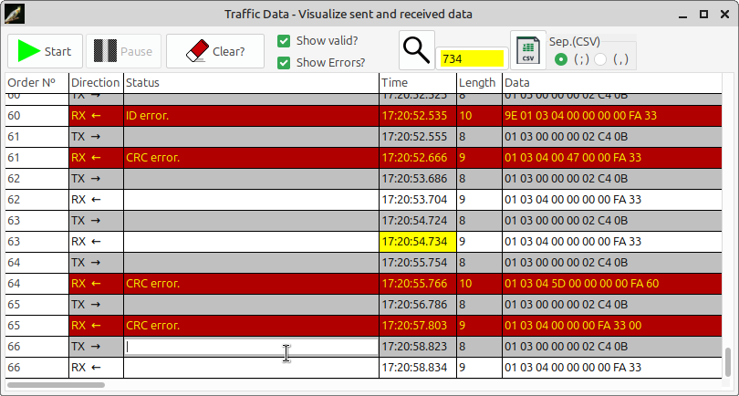](https://github.com/ortegahernandes/ScanBus-BR-Simulator-Modbus/blob/main/Imagens/Traffic_Data.png)

## Features

- Display only valid communication frames.
- Display only communication errors.
- Export captured data to CSV format.
- Select the CSV separator (comma or semicolon).
- Search for hexadecimal values or text.
- Automatic highlighting of search results.
- Error highlighting directly in the table.
- Start and Pause data acquisition at any time.

> **Note**
>
> The Traffic Data window may be closed while acquisition continues in the background.

* * *

# Connection Settings

ScanBus-BR supports both **Serial Modbus RTU** and **Modbus TCP/IP** communication.

Connection parameters can be configured independently for each protocol.

* * *

# Serial Modbus RTU

[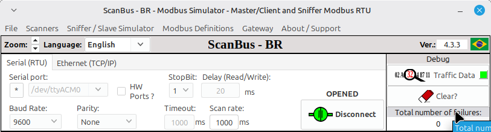](https://github.com/ortegahernandes/ScanBus-BR-Simulator-Modbus/blob/main/Imagens/menu_rtu.png)

## Available Settings

### Rescan Ports

Refreshes the list of available serial ports.

Useful when a USB/RS485 converter is connected after ScanBus-BR has already been started.

* * *

### Serial Port

Select the serial interface connected to the Modbus network.

* * *

### Baud Rate

Choose the communication speed supported by the connected device.

* * *

### Parity

Supported modes:

- None
- Even
- Odd

* * *

### Stop Bits

Supported values:

- 1
- 2

* * *

### Read / Write Delay

Adds a delay between Modbus requests.

This option is useful when communicating with slower devices or when multiple tables are active simultaneously.

* * *

### Timeout

Maximum waiting time for a device response.

If no response is received before the timeout expires, the request is considered failed.

* * *

### Scan Rate

Defines how frequently ScanBus-BR polls the connected device.

Lower values provide faster updates but increase communication traffic.

* * *

# Modbus TCP/IP

[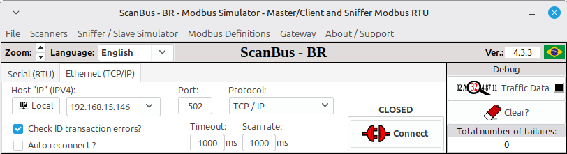](https://github.com/ortegahernandes/ScanBus-BR-Simulator-Modbus/blob/main/Imagens/menu_tcp.png)

## Copy Local IP

Copies the computer's local IP address.

This is useful because industrial devices are usually configured within the same subnet.

* * *

### Server Address

Supports:

- IPv4 addresses
- Host names (DNS)

> **Note**
>
> When using DNS or slow Internet connections, increase the timeout value if the connection cannot be established.

* * *

### TCP Port

The default Modbus TCP port is:

```
502
```

Any custom port may also be used.

* * *

### Communication Protocol

Supported options:

- Modbus TCP/IP
- Modbus RTU over TCP/IP

* * *

### Transaction Verification

Verifies transaction identifiers to ensure that every received response belongs to the corresponding request.

For unreliable or high-latency networks, this verification can optionally be disabled.

* * *

### Auto Connect

Automatically reconnects whenever communication is interrupted.

> **Warning**
>
> Incorrect configuration may create an endless reconnect loop.

* * *

### Timeout

Maximum waiting time for server responses.

* * *

### Scan Rate

Defines the polling interval for TCP communication.

* * *

# Advanced Communication Settings

[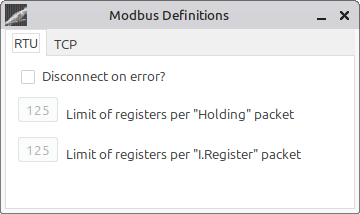](https://github.com/ortegahernandes/ScanBus-BR-Simulator-Modbus/blob/main/Imagens/Modbus_Definition_RTU.png)

[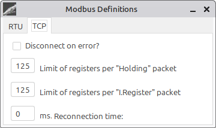](https://github.com/ortegahernandes/ScanBus-BR-Simulator-Modbus/blob/main/Imagens/Modbus_Definition_TCP.png)

The Advanced Settings window provides additional control over communication behavior.

## Available Options

### Automatic Reconnection

Reconnect automatically after communication loss.

(TCP/IP only.)

* * *

### Read Only Mode

Disables every write command.

Useful when monitoring production systems where accidental writes must be prevented.

* * *

### Maximum Holding Register Packet Size

Some Modbus devices cannot process the standard maximum of **125 registers** in a single request.

ScanBus-BR automatically splits large requests into smaller packets.

* * *

### Maximum Input Register Packet Size

Applies the same packet fragmentation to Input Register requests.

* * *

### Disconnect on Communication Error

Automatically closes the connection after a communication failure.

This can simplify recovery in unstable networks.

* * *

# Data Reading Screen

[](https://github.com/ortegahernandes/ScanBus-BR-Simulator-Modbus/blob/main/Imagens/Scanbus-BR-linux.png)

The main reading window provides continuous monitoring of Modbus registers.

Values are updated automatically according to the configured scan rate.

* * *

## Available Information

- Current register values
- Communication status
- Total received packets
- Current response time
- Minimum response time
- Average response time
- Maximum response time

* * *

## Numeric Display Formats

The same register can be viewed in multiple formats.

Supported formats include:

- 16-bit Unsigned Integer
- 16-bit Signed Integer
- 32-bit Unsigned Integer
- 32-bit Signed Integer
- IEEE754 Floating Point
- 64-bit Unsigned Integer
- 64-bit Signed Integer
- IEEE754 Double Precision

* * *

## Byte Order

Every numeric format supports:

- Big Endian
- Little Endian
- Big Endian + Byte Swap
- Little Endian + Byte Swap

* * *

## Address Display Modes

Addresses may be displayed as:

- Relative Address (Base 0)
- Absolute Address (Base 1)
- Hexadecimal Address

* * *

## Toolbar

The toolbar provides quick access to several functions.

- Create a new Universal Table.
- Perform a single read operation.
- Open the Automatic Simulation window.
- Save communication logs.
- Open the Wide Vision tool.

# Register Write Windows

ScanBus-BR provides dedicated write windows for **16-bit**, **32-bit**, and **64-bit** values, allowing data to be written in the most appropriate format for each application.

The available options automatically adapt according to the selected Modbus function.

* * *

# 16-bit Write Window

[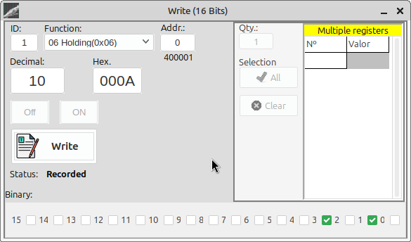](https://github.com/ortegahernandes/ScanBus-BR-Simulator-Modbus/blob/main/Imagens/write_16bits.png)

The 16-bit write window supports all standard Modbus write functions.

## Supported Functions

- Function 05 — Write Single Coil
- Function 06 — Write Single Holding Register
- Function 15 — Write Multiple Coils
- Function 16 — Write Multiple Holding Registers

### Maximum Write Size

| Function                   | Maximum       |
|----------------------------|---------------|
| Multiple Coils             | 1998 Coils    |
| Multiple Holding Registers | 123 Registers |

* * *

## Value Formats

Single register values may be entered as:

- Decimal
- Hexadecimal
- Binary

This greatly simplifies debugging and firmware validation.

* * *

# 32-bit Write Window

[](https://github.com/ortegahernandes/ScanBus-BR-Simulator-Modbus/blob/main/Imagens/write_32bits.png)

The 32-bit write window is intended for devices that store values across two consecutive Holding Registers.

Supported formats include:

- Unsigned Integer
- Signed Integer
- IEEE754 Floating Point

Values may be entered in:

- Decimal
- Hexadecimal

* * *

## Transmission Modes

Two write methods are available:

### Function 06

Writes each register individually.

This option offers maximum compatibility with older devices.

* * *

### Function 16

Writes both registers in a single Modbus command.

This is the default and recommended option whenever supported by the target device.

* * *

# 64-bit Write Window

[](https://github.com/ortegahernandes/ScanBus-BR-Simulator-Modbus/blob/main/Imagens/write_64bits.png)

The 64-bit write window allows writing values stored across four consecutive Holding Registers.

Supported formats include:

- Unsigned 64-bit Integer
- Signed 64-bit Integer
- IEEE754 Double Precision

All byte-order options available throughout ScanBus-BR are supported.

* * *

# Automatic Register Simulation

[](https://github.com/ortegahernandes/ScanBus-BR-Simulator-Modbus/blob/main/Imagens/Auto_Simulation.png)

The Automatic Simulation tool continuously writes values to selected Holding Registers.

It is especially useful for:

- PLC testing
- HMI development
- SCADA validation
- Embedded firmware testing
- Communication stress testing

* * *

## Simulation Modes

Each configured register may operate independently using one of the following modes:

- Increment
- Decrement
- Random

* * *

## Adjustable Parameters

Each simulated register supports:

- Independent address selection
- Write interval
- Step value
- Minimum value
- Maximum value

Negative values are fully supported.

* * *

## Write Function

The simulator can operate using:

- Function 06 (Write Single Register)
- Function 16 (Write Multiple Registers)

Function 16 is recommended whenever the target device supports it.

* * *

> **Important**
>
> Automatic Simulation is available only while the simulation window remains open.
>
> Registers configured for automatic updates are highlighted in **green** within the main table.

* * *

# Communication Log

[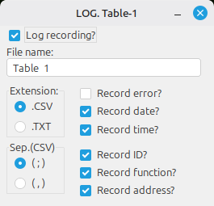](https://github.com/ortegahernandes/ScanBus-BR-Simulator-Modbus/blob/main/Imagens/Log_register.png)

The integrated logging system records communication activity for later analysis.

Logs can be generated automatically during communication with the Modbus device.

* * *

## Log Options

- Enable or disable logging
- Select the output filename
- TXT output
- CSV output
- Select comma or semicolon separator

* * *

## Recorded Information

The log may include:

- Date
- Time
- Device ID
- Function Code
- Register Address
- Communication Errors

* * *

## File Location

### Windows

The log is stored in the same directory as the ScanBus-BR executable.

### Linux

Depending on the distribution, the file may be stored either beside the executable or inside the user's Home directory.

* * *

# Universal Tables

[](https://github.com/ortegahernandes/ScanBus-BR-Simulator-Modbus/blob/main/Imagens/Universal_table.png)

Universal Tables provide an independent floating window for monitoring additional Modbus registers.

Multiple Universal Tables may be opened simultaneously.

Each table operates independently from the main window.

* * *

## Supported Register Sizes

- 125 × 16-bit Registers
- 64 × 32-bit Values
- 32 × 64-bit Values

* * *

## Supported Numeric Formats

- Binary
- Unsigned Integer
- Signed Integer
- IEEE754 Float
- IEEE754 Double

* * *

## Byte Ordering

Every Universal Table supports:

- Big Endian
- Little Endian
- Big Endian + Byte Swap
- Little Endian + Byte Swap

* * *

## Advantages

Universal Tables are ideal when monitoring several unrelated memory regions simultaneously.

Each window can use different:

- Address
- Format
- Byte Order
- Register Size

This greatly simplifies diagnostics in complex PLCs and embedded devices.

* * *

# Time Graph

[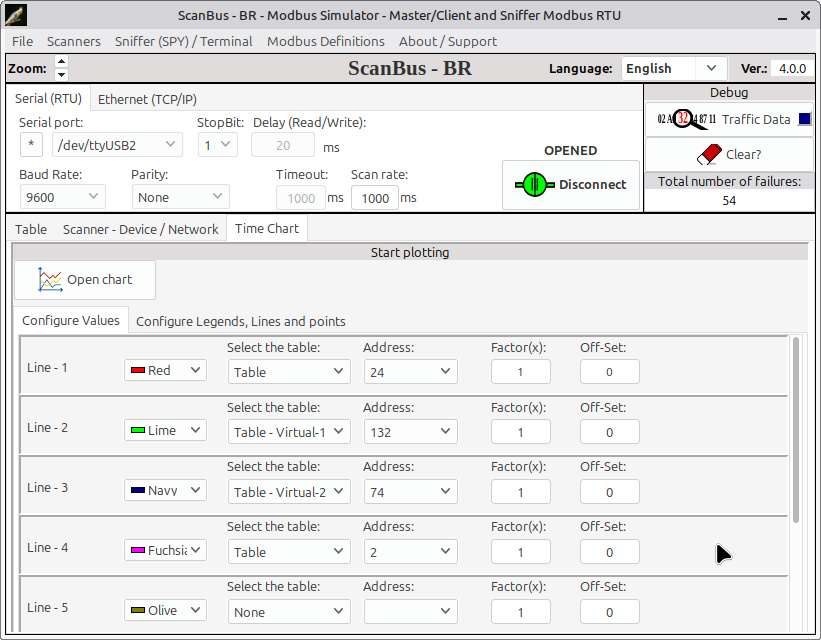](https://github.com/ortegahernandes/ScanBus-BR-Simulator-Modbus/blob/main/Imagens/Graphic_time_1.png)

[](https://github.com/ortegahernandes/ScanBus-BR-Simulator-Modbus/blob/main/Imagens/Graphic_time_2.png)

The Time Graph tool plots Modbus register values over time.

It is particularly useful for observing trends, oscillations, and dynamic system behavior.

* * *

## Graph Features

Up to **8 independent traces** may be displayed simultaneously.

Each trace supports:

- Custom caption
- Multiplication factor
- Offset
- Line width
- Line style
- Marker points

[](https://github.com/ortegahernandes/ScanBus-BR-Simulator-Modbus/blob/main/Imagens/Graphic_time_3.png)

* * *

## Display Options

The graph appearance can be customized through:

- Background Color
- Grid Color
- Grid Visibility
- Automatic Scale
- Manual Minimum
- Manual Maximum
- Time Scale

These settings allow the graph to be optimized for both slow-changing variables and high-speed signals.

* * *

# Device Library

[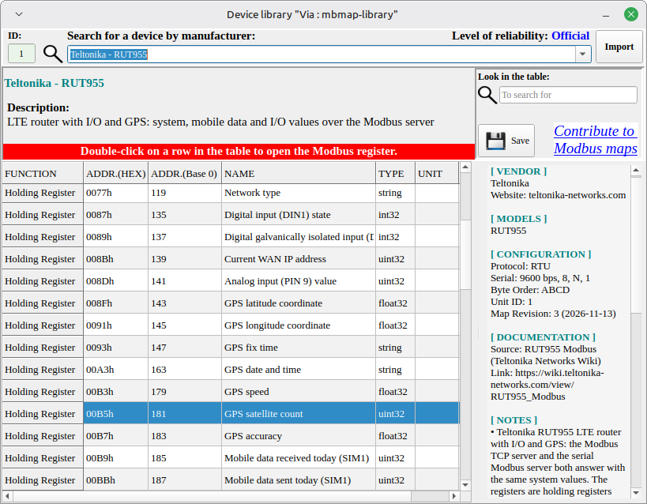](https://github.com/ortegahernandes/ScanBus-BR-Simulator-Modbus/blob/main/Imagens/Device%20library.png)

The **Device Library** lets you find the Modbus register map of a device by brand or model.

Instead of entering registers one by one, you pick the device and load a ready-made map to start communicating.

* * *

## Finding a Device

There are two ways to choose a device in the selection box:

- **Select** it from the drop-down list.
- **Type** the brand (or part of the name). The box autocompletes as you type.

> **Note**
>
> The maps are stored in `maps.zip`, located beside the ScanBus-BR executable. Each device is described by a JSON file listed in the `index.json` of the zip.

* * *

## Map Source and Contributing

The maps in the Device Library come from **[mbmap-library](https://github.com/nobrega8/mbmap-library)**, an open library of Modbus register maps in the **MBMap** format (JSON, `.mbmap.json` files), created and maintained by **[nobrega8](https://github.com/nobrega8)**.

Many thanks to the maintainer and to everyone who contributes maps to the project.

Each map describes one device model: the manufacturer, how to connect to it and what every register means.

### Contributing New Maps

Is your device missing, or did you find a wrong register? Contribute to **mbmap-library** so that everyone benefits:

1. Read the [CONTRIBUTING.md](https://github.com/nobrega8/mbmap-library/blob/main/CONTRIBUTING.md) of the project.
2. Write your map following the [MBMap specification](https://github.com/nobrega8/mbmap-library/blob/main/SPEC.md). Maps are stored as `maps/<vendor>/<model>.mbmap.json`, and the [JSON Schema](https://github.com/nobrega8/mbmap-library/blob/main/schema/mbmap-2.schema.json) of the project describes the structure of the file.
3. Check your file with the validator provided by the project (`tools/validate/validate.py`). The exact command is described in the CONTRIBUTING.md.

> **Note**
>
> The older CSV-based format (`.mbmap`, version 1) is deprecated. New maps must use the JSON format.

> **Note**
>
> The maps are provided as is. Always check a map against the manufacturer's documentation before writing to a live device.

* * *

## Device Information

Besides the registers, each map carries extra information that is useful for communication. It is shown in the panel beside the register table.

| Section           | Content                                                                   |
|-------------------|---------------------------------------------------------------------------|
| **Vendor**        | Manufacturer and website                                                  |
| **Models**        | Models covered by the map                                                 |
| **Configuration** | Protocol, serial settings, firmware, byte order, Unit ID and map revision |
| **Documentation** | Documentation source and link                                             |
| **Notes**         | Important remarks about the device                                        |

The panel also shows a device description and a **reliability level** for the map:

| Level          | Meaning                                   |
|----------------|-------------------------------------------|
| **Official**   | Based on the manufacturer's documentation |
| **Verified**   | Tested in the field                       |
| **Unofficial** | Not official, use with care               |
| **Unknown**    | No information available                  |

* * *

## Register Table

When a device is selected, the table lists every register in the map:

- Area
- Address (hexadecimal)
- Address (decimal)
- Name
- Type
- Unit
- Access

The search box filters the table while you type. It searches all columns and ignores upper/lower case (for example `voltage`, `0010h`, `float32` or `RW`).

> **Note**
>
> Before using a register or importing the map, check the **Device ID** field. The suggested value comes from the map when it defines one, otherwise it is `1`.

* * *

## Double-Click: a Single Register

**Double-click** a row in the table to open **only that register** in a separate window, ready for communication.

The window is a [Universal Table](#universal-tables). The serial settings of the map are applied and the register name is kept as an alias.

* * *

## Import: All Registers

The **Import** button loads the whole map:

1. Applies the communication settings defined in the map (for example, serial) and the Device ID.
2. Stores each register name as an alias. Bits inside a word receive the bit name.
3. Opens the **Register Window** with every item of the map, **initially all disabled**.

* * *

## Exporting the Register List

The **Save** button of the Device Library exports the register list of the selected device as:

- TXT
- CSV
- RTF

* * *

# Register Window

[](https://github.com/ortegahernandes/ScanBus-BR-Simulator-Modbus/blob/main/Imagens/Library_Window.png)

The Register Window shows all registers imported from the Device Library.

Each row has a checkbox in the **Active** column. Only checked rows are read from the device.

* * *

## Selecting Registers

- Check **item by item** to read only what you need.
- Use the **select all** button to enable the entire table.
- Use the **clear all** button to uncheck everything at once.

* * *

## Columns

- Active
- Register (Dec.)
- Register (Hex.)
- Alias
- Function
- Value
- Unit
- Type
- Access

The displayed value already applies the register type (`uint16`, `int32`, `float32`, bit, etc.), scale and offset, and the byte and word order defined in the map.

* * *

## Writing to a Register

Double-click a row to write to that register.

Writing is only available for coils and holding registers with write access, and only while ScanBus-BR is connected to the device.

* * *

## Communication Indicator

The window shows the communication status with an LED and a packet counter.

| LED         | Meaning                                             |
|-------------|-----------------------------------------------------|
| Green blink | The read cycle finished with all responses OK       |
| Red blink   | At least one register had an error during the cycle |
| Off         | No new response                                     |

The **packet counter** counts complete read cycles, meaning one pass over all active registers.

> **Note**
>
> The counter is reset whenever a new device is loaded.

* * *

# Network Scanners

One of the strongest features of ScanBus-BR is its collection of built-in scanners.

Instead of manually testing each Modbus address or communication parameter, the scanners automate the discovery process, significantly reducing commissioning and troubleshooting time.

* * *

# Device / Network Scanner

Automatically discovers valid Modbus devices, supported functions and accessible registers.

[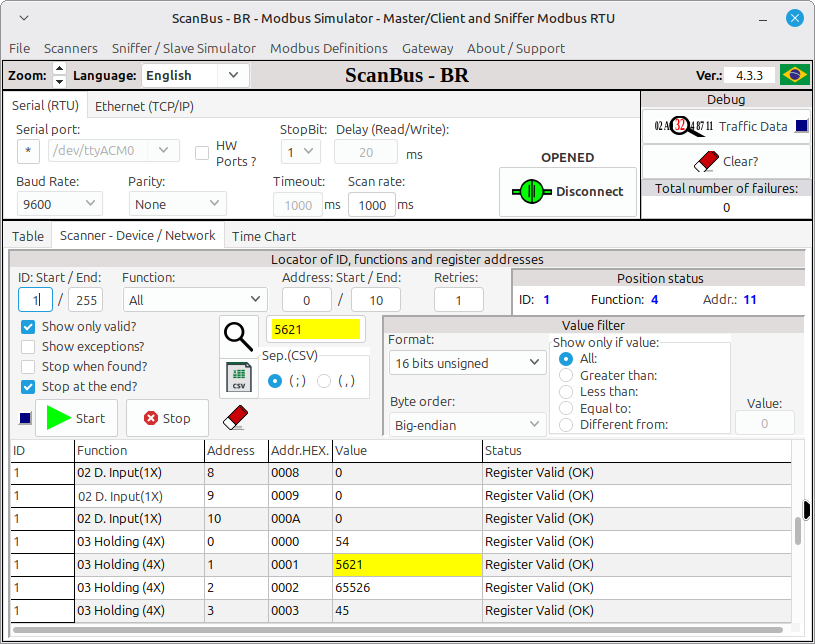](https://github.com/ortegahernandes/ScanBus-BR-Simulator-Modbus/blob/main/Imagens/Scan_Device.png)

The scanner is especially useful when little or no documentation is available for the target equipment.

Typical applications include:

- PLC commissioning
- Reverse engineering
- Industrial maintenance
- Device validation
- Unknown equipment analysis

* * *

## Features

- Automatic Device ID scanning
- Function Code scanning
- Register Address scanning
- CSV export
- Search tool
- Error highlighting
- Exception code detection
- Register value filtering

* * *

## Display Options

### Show Only Valid Data

Displays only successful Modbus responses.

This prevents the table from being filled with timeout or communication error messages.

* * *

### Show Exceptions

Displays Modbus Exception Responses.

An exception usually indicates that the device exists but the requested register or function is invalid.

* * *

### Stop When Found

Stops the scan immediately after locating the first valid register.

Ideal for quickly identifying unknown devices.

* * *

### Stop at End

Stops automatically after scanning Device ID 255.

When disabled, the scanner continuously repeats the search.

* * *

### CSV Export

Exports all discovered information for later analysis.

The separator may be configured as:

- Comma
- Semicolon

* * *

### Search

Search for any text or numeric value within the results table.

Matching entries are automatically highlighted.

* * *

# Value Filters

The scanner can filter results according to the received register value.

Available filters include:

- All Values
- Greater Than
- Less Than
- Equal To
- Different From

* * *

## Supported Data Formats

- 16-bit Unsigned
- 16-bit Signed
- 32-bit Unsigned
- 32-bit Signed
- IEEE754 Floating Point

* * *

## Supported Byte Orders

- Big Endian
- Little Endian
- Big Endian + Byte Swap
- Little Endian + Byte Swap

* * *

> **Note**
>
> Every 32-bit value occupies two consecutive Holding Registers.

* * *

# Serial RTU Scanner

Automatically searches for the serial communication parameters required to communicate with an unknown Modbus RTU device.

[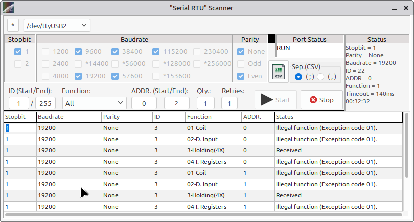](https://github.com/ortegahernandes/ScanBus-BR-Simulator-Modbus/blob/main/Imagens/Scan_RTU.png)

Instead of manually trying dozens of communication combinations, ScanBus-BR performs the process automatically.

* * *

## Search Parameters

The scanner can automatically test:

- Baud Rate
- Parity
- Stop Bits
- Slave ID
- Function Code
- Register Address

* * *

## Supported Parity

- None
- Even
- Odd

* * *

## Supported Stop Bits

- 1
- 2

* * *

## Function Scan

Select a single Modbus function or allow ScanBus-BR to search using all standard read functions:

- Function 01 – Read Coils
- Function 02 – Read Discrete Inputs
- Function 03 – Read Holding Registers
- Function 04 – Read Input Registers

* * *

## Address Range

Registers from:

0

to

65535

may be scanned.

* * *

## How It Works

The scanner systematically combines all selected communication parameters until valid Modbus responses are received.

Unlike many generic serial scanners, ScanBus-BR validates complete Modbus frames, including CRC verification.

This greatly reduces false positives caused by electrical noise or random serial traffic.

* * *

## Performance Considerations

The default configuration requires approximately **2.5 hours** to complete.

Each additional parameter added to the search approximately doubles the scanning time.

To improve performance:

- Limit the Baud Rate list whenever possible.
- Limit the Device ID range.
- Limit the Register Address range.
- Select only the required Function Codes.

The more information you already know about the target device, the faster the scan will complete.

* * *

# TCP/IP Scanner

Automatically searches for Modbus TCP devices within the local network.

[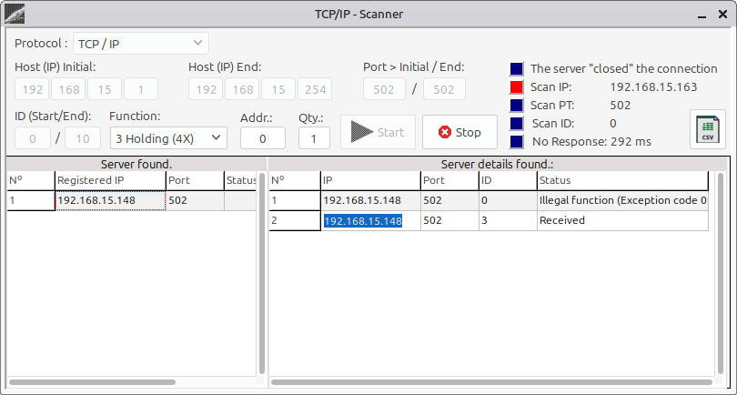](https://github.com/ortegahernandes/ScanBus-BR-Simulator-Modbus/blob/main/Imagens/Scan_TCP.png)

The TCP Scanner is useful when the IP address of a Modbus device is unknown.

* * *

## Search Parameters

- IP Address
- TCP Port
- Device ID

* * *

## Requirements

Before running the scan, you should already know:

- A valid Modbus Function Code
- A valid Register Address

These parameters are used to verify whether each detected device responds correctly.

* * *

## Important Notes

The target device must belong to the same IP subnet as the computer running ScanBus-BR.

Scanning multiple subnets is not supported.

* * *

# Wide Vision

The Wide Vision tool makes it easy to identify register activity across large memory areas.

[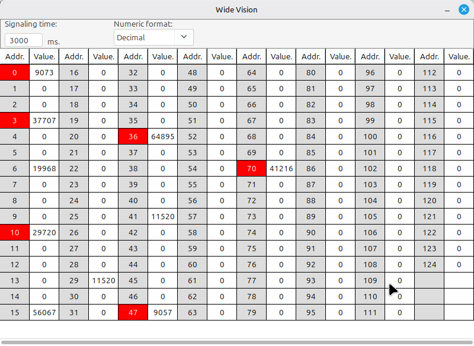](https://github.com/ortegahernandes/ScanBus-BR-Simulator-Modbus/blob/main/Imagens/wide_vision_1.png)

Instead of continuously monitoring individual values, Wide Vision highlights every register that changes over time.

This is particularly useful when reverse engineering unknown equipment.

* * *

## Features

- Real-time activity monitoring
- Automatic change detection
- Adjustable highlight duration
- Visual indication of changing registers

Whenever a register changes, its address is highlighted in **red** for the configured signaling time.

This makes dynamic values immediately visible without requiring constant observation.

* * *

# Modbus Sniffer (SPY)

The integrated **Sniffer** is one of the flagship features of ScanBus-BR.

Instead of acting as a Modbus Master, the Sniffer passively monitors communication between an existing Master/Client and one or more Slave devices.

This makes it an invaluable tool for troubleshooting, reverse engineering, firmware validation and protocol analysis.

* * *

## Important Notes

Since communication is monitored directly from the RS485 bus, the software must determine which frames belong to the Master and which belong to the Slave.

Although several validation algorithms are used, extremely rare false detections may still occur.

For the highest reliability, USB/RS485 converters based on the **CH340** or **CH343** chipsets are strongly recommended.

* * *

# Serial Connection

[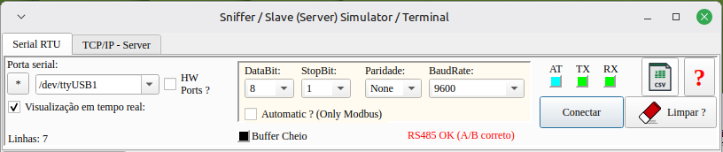](https://github.com/ortegahernandes/ScanBus-BR-Simulator-Modbus/blob/main/Imagens/Menu_Sniffer.png)

## Available Controls

### Rescan

Refreshes the list of available serial ports.

Useful when the USB converter is connected after ScanBus-BR has already been started.

* * *

### COM Port

Selects the serial interface connected to the RS485 network.

* * *

### Virtual Port (Linux)

Displays internal virtual serial devices available under Linux.

* * *

### Data Bits

Select the number of data bits.

For Modbus RTU this value should always be **8**.

* * *

### Stop Bits

Supports:

- 1
- 2

* * *

### Parity

Supported options:

- None
- Even
- Odd

* * *

### Baud Rate

Select the baud rate used by the monitored network.

* * *

# Status LEDs

Several LEDs provide immediate information about communication status.

## Buffer Full

Indicates that the Merge Table has reached its maximum capacity.

* * *

## AT

Indicates serial communication status.

Color meanings:

| Color  | Meaning                |
|--------|------------------------|
| Blue   | Never connected        |
| Yellow | Connection problem     |
| Red    | Connected but inactive |
| Green  | Active communication   |
| Aqua   | Disconnected           |

* * *

## TX

Indicates data transmitted by the Modbus Master.

* * *

## RX

Indicates data transmitted by the Modbus Slave.

* * *

# Real-Time Visualization

Two acquisition modes are available.

## Real-Time Enabled

The display updates every:

- 50 received frames

or

- 100 ms without new data

This mode offers immediate feedback but may occasionally produce minor misalignment between transmitted and received frames.

* * *

## Real-Time Disabled

Frames are displayed only when:

- the capture buffer becomes full

or

- acquisition is stopped manually.

This mode minimizes frame misalignment and is recommended when generating CSV files for offline analysis.

* * *

# Additional Functions

## Connect / Disconnect

Starts or stops communication capture.

When using the serial terminal for non-Modbus traffic, the Modbus decoder may remain disabled.

* * *

## Clear

Removes all captured frames.

* * *

## RS485 A/B Detection

Automatically detects whether the RS485 A and B wires are reversed.

Available only for Modbus RTU communication.

* * *

# TCP/IP (Server) Connection

[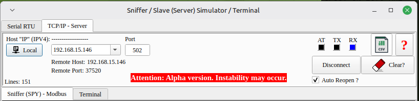](https://github.com/ortegahernandes/ScanBus-BR-Simulator-Modbus/blob/main/Imagens/Menu_Sniffer_tcp.png)

## AT

Indicates TCP/IP communication status.

Color meanings:

| Color  | Meaning                |
|--------|------------------------|
| Blue   | Never connected        |
| Yellow | Connection problem     |
| Red    | Connected but inactive |
| Green  | Active communication   |
| Aqua   | Disconnected           |

* * *

## TX

Indicates data transmitted by the Modbus Client.

* * *

## RX

Indicates data transmitted by the Modbus Server.

# Serial Terminal

The integrated terminal can also be used independently of the Modbus decoder.

[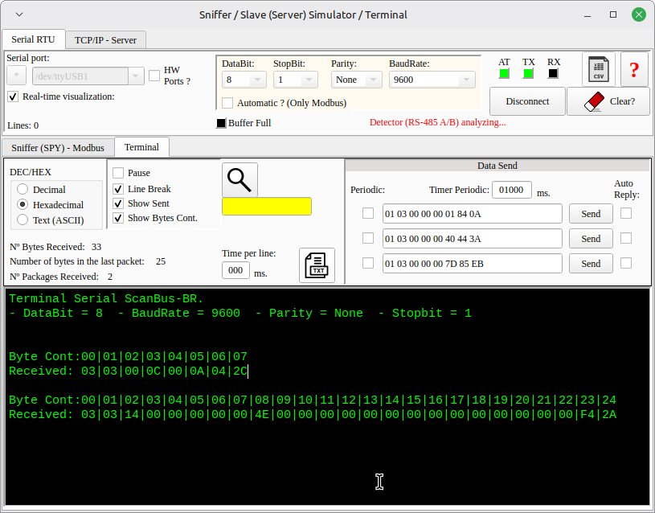](https://github.com/ortegahernandes/ScanBus-BR-Simulator-Modbus/blob/main/Imagens/Terminal_serial.png)

## Display Formats

Incoming and outgoing data may be displayed as:

- Decimal
- Hexadecimal
- ASCII Text

* * *

## Terminal Options

- Display transmitted bytes
- Custom byte separator
- Packet line spacing
- Packet counter
- Line counter
- Search function

* * *

# Internal Modbus Slave / Server Simulator

One of the most unique features of ScanBus-BR is the built-in Modbus RTU Slave Simulator.

Instead of requiring external hardware, ScanBus-BR can emulate an entire Modbus Slave device directly inside the Sniffer.

[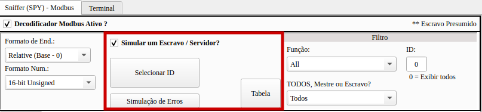](https://github.com/ortegahernandes/ScanBus-BR-Simulator-Modbus/blob/main/Imagens/Filter_Slave_Save_Sniffer.png)

This feature is extremely useful during:

- PLC development
- HMI testing
- SCADA validation
- Firmware debugging
- Master software development

* * *

## Slave / Server ID Selection

[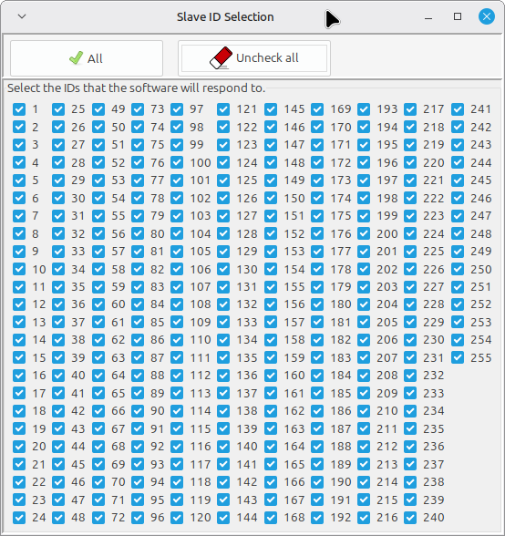](https://github.com/ortegahernandes/ScanBus-BR-Simulator-Modbus/blob/main/Imagens/Slave_ID.png)

Individual Slave IDs may be enabled or disabled.

Available commands:

- Select All IDs
- Clear All IDs

* * *

# Error Simulation

The Slave Simulator can intentionally generate communication errors.

[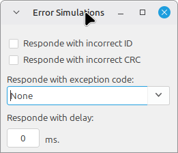](https://github.com/ortegahernandes/ScanBus-BR-Simulator-Modbus/blob/main/Imagens/Error_simulations.png)

Supported simulations:

- Invalid Slave ID
- Invalid CRC (only Serial RTU)
- Communication Delay

It can also generate every standard Modbus Exception Response.

Supported exception codes:

| Code | Description                             |
|------|-----------------------------------------|
| 01   | Illegal Function                        |
| 02   | Illegal Data Address                    |
| 03   | Illegal Data Value                      |
| 04   | Slave Device Failure                    |
| 05   | Acknowledge                             |
| 06   | Slave Device Busy                       |
| 07   | Negative Acknowledge                    |
| 08   | Memory Parity Error                     |
| 0A   | Gateway Path Unavailable                |
| 0B   | Gateway Target Device Failed to Respond |

* * *

# Editable Slave / Server Memory

[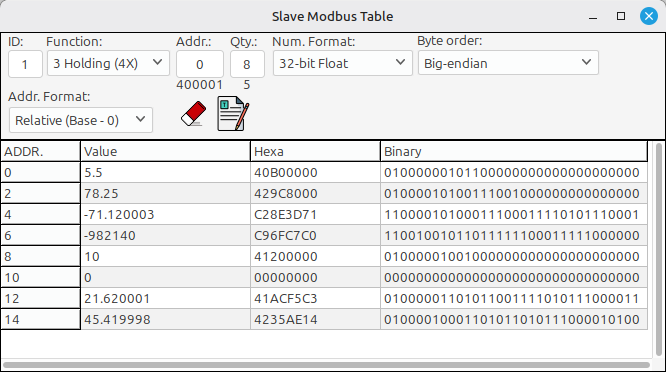](https://github.com/ortegahernandes/ScanBus-BR-Simulator-Modbus/blob/main/Imagens/Table_Slave.png)

The simulated Slave memory can be edited interactively.

Supported formats:

- 16-bit Unsigned
- 16-bit Signed
- 32-bit Unsigned
- 32-bit Signed
- IEEE754 Float

Supported byte orders:

- Big Endian
- Little Endian
- Big Endian + Byte Swap
- Little Endian + Byte Swap

Available commands:

- Save Memory
- Load Memory
- Clear Memory
- Edit Values

* * *

# Manual Register Editing

[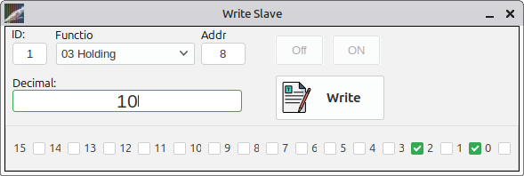](https://github.com/ortegahernandes/ScanBus-BR-Simulator-Modbus/blob/main/Imagens/Write_Slave.png)

Registers may be edited individually.

Supported operations include:

- Device ID
- Function Code
- Register Address
- Register Value
- Coil ON/OFF

* * *

> **Note**
>
> The internal simulator automatically supports all standard Modbus functions (01, 02, 03, 04, 05, 06, 15 and 16) for every address between **0** and **65535**.

* * *

# Merge Table

[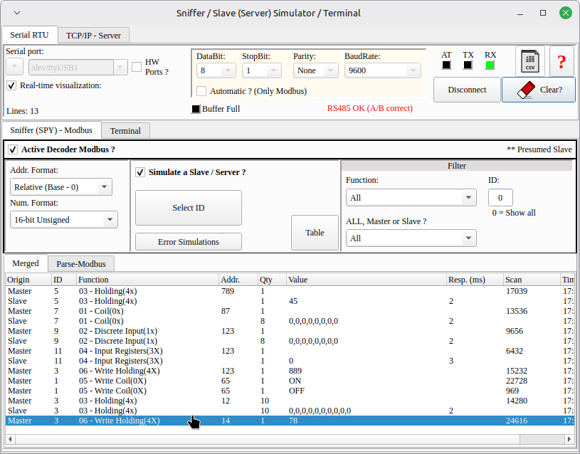](https://github.com/ortegahernandes/ScanBus-BR-Simulator-Modbus/blob/main/Imagens/Sniffer_SPY_Merge.png)

The Merge Table reconstructs complete Modbus transactions by combining Master requests and Slave responses.

This allows communication to be analyzed exactly as it occurred.

Supported functions:

- Read Coils
- Read Discrete Inputs
- Read Holding Registers
- Read Input Registers
- Write Single Coil
- Write Single Register
- Partial support for Functions 15 and 16

Supported filters include:

- Master / Client only
- Slave only (Only Serial RTU)
- Device ID
- Function Code

CSV files generated by the Merge Table can be analyzed using AI tools such as ChatGPT for troubleshooting and protocol interpretation.

* * *

# Parse Table

[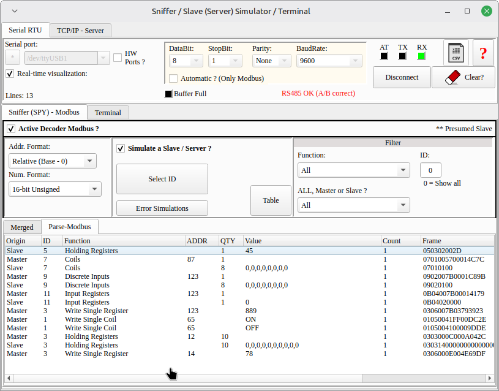](https://github.com/ortegahernandes/ScanBus-BR-Simulator-Modbus/blob/main/Imagens/Sniffer_SPY_Parse.png)

The Parse Table groups identical Modbus transactions together.

Instead of displaying repeated frames individually, identical messages are counted and summarized.

This greatly simplifies long captures.

* * *

## FTDI Users

If your USB/RS485 converter uses an FTDI chipset, set the **USB Latency Timer** to **1 ms** in the Windows Device Manager.

For the best overall performance, CH340 and CH343 converters remain the recommended option.

## Converters with PL2303 chip:

There is an incompatibility with this chip; Windows may restart on its own in the sniffer/terminal.

* * *
